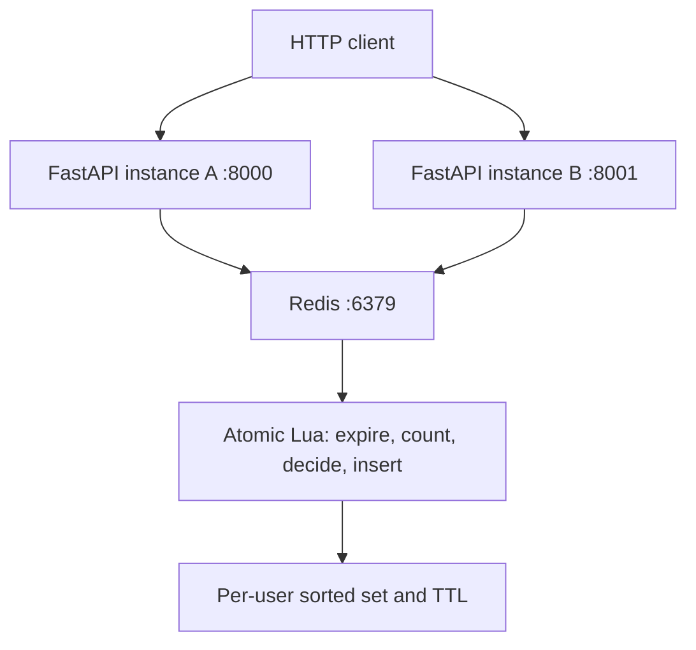

# Intelligent API Rate Limiter

A seven-day systems engineering project exploring exact sliding-window rate limiting, from an in-process Python implementation to a shared Redis backend coordinating two local FastAPI instances.

**Policy:** accept at most 100 requests per demo user in any rolling 60-second window. Excess requests receive HTTP 429 with `Retry-After`; a Redis outage produces HTTP 503 rather than bypassing the quota.

## Architecture



The original implementation uses a dictionary, deque, monotonic time and a thread lock. Each process owns its own state. The Redis version uses server time, unique request IDs, sorted sets and an atomic Lua script to coordinate one quota across both processes. The header `X-Demo-User` is a development-only identity, not authentication.

## Observed experiment results

| Experiment | Accepted | Rejected | Outcome |
|---|---:|---:|---|
| Sequential, one in-memory instance (101 requests) | 100 | 1 | Sampled results match policy |
| Concurrent, one in-memory instance (150 tasks, 20 workers) | 100 | 50 | Pass |
| Sequential, two independent instances (120 requests) | 120 | 0 | Global quota violation reproduced |
| Sequential, two Redis-backed instances (120 requests) | 100 | 20 | Pass |
| Concurrent, two Redis-backed instances (200 tasks, 20 workers) | 100 | 100 | Pass |

The Day 06 concurrent run measured **498.82 HTTP responses/s**, **34.16 ms mean latency**, and **43.80 ms P95 latency**, with zero unexpected responses and 100 valid Retry-After headers. Throughput includes both HTTP 200 and HTTP 429 responses. These are single-machine observations, not production benchmarks or a controlled backend speed comparison.

Day 07: both instances returned HTTP 200 when Redis was healthy, HTTP 503 when Redis was stopped, and HTTP 200 after Redis restarted (6/6 checks). Quota persistence across restart was not tested.

## Quick start (Windows PowerShell + WSL2)

Prerequisites: Python 3, Git and an installed Ubuntu WSL2 distribution. Redis was tested with Ubuntu's Redis 8.0.5 and Python client 8.1.0.

```powershell
py -m venv .venv
.\.venv\Scripts\python.exe -m pip install -r requirements.txt
```

In a separate Ubuntu terminal (keep it open):

```bash
sudo apt update
sudo apt install redis-server
sudo service redis-server start
redis-cli ping
```

Expected: `PONG`. From Windows PowerShell, verify Python connectivity:

```powershell
.\.venv\Scripts\python.exe -c "import redis; print(redis.Redis(host='127.0.0.1',port=6379,socket_connect_timeout=3,socket_timeout=3).ping())"
```

Expected: `True`. Keep Redis bound to loopback; do not expose its port publicly.

Start the two application instances in separate PowerShell terminals:

```powershell
.\.venv\Scripts\python.exe -m uvicorn main_redis:app --host 127.0.0.1 --port 8000
```

```powershell
.\.venv\Scripts\python.exe -m uvicorn main_redis:app --host 127.0.0.1 --port 8001
```

Open `http://127.0.0.1:8000/docs` for the interactive API documentation. `/health` verifies Redis connectivity and `/limiter-config` exposes the configured quota.

```powershell
Invoke-RestMethod http://127.0.0.1:8000/health
.\.venv\Scripts\python.exe test_distributed.py
.\.venv\Scripts\python.exe test_distributed_concurrency.py
```

For the original version, stop the Redis-backed APIs and run `main:app` on port 8000 (and on 8001 only for the independent-state demonstration). Run `test_http.py`, `test_concurrency.py`, `test_user_isolation.py`, `test_edge_cases.py`, and `test_multi_instance.py` as applicable. The original `test_http.py` uses a fixed demo identity, so use a fresh server state or allow the window to expire before repeating it.

### Failure and recovery experiment

Run `test_failure_recovery.py healthy`, then stop Redis with `sudo service redis-server stop` in Ubuntu, run `test_failure_recovery.py failure`, restart Redis (`sudo service redis-server start`), check `redis-cli ping`, then run `test_failure_recovery.py recovery`. Use the virtual-environment Python for each script. Do this only in an isolated local environment and restore Redis even if a check fails.

## Documentation

- [Architecture](docs/Architecture.md)
- [Algorithm analysis](docs/Algorithm_Analysis.md)
- [Benchmark report](docs/Benchmark_Report.md)
- [Production limitations](docs/Production_Limitations.md)

## Development journey

Day 01: deque sliding window; Day 02: independent user quotas; Day 03: memory reclamation; Day 04: HTTP integration; Day 05: concurrency and edge cases; Day 06: shared Redis state; Day 07: failure/recovery and documentation.

Built as part of Weekly Problem Identification, Week 02. Educational prototype; not production-ready.
